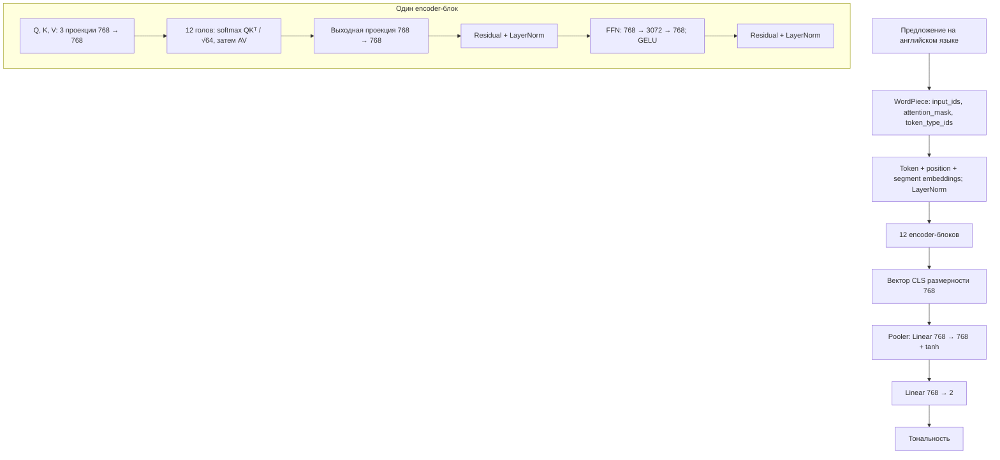

# Анализ узких мест и ускорения BERT на CPU

Домашнее задание № 1 по курсу «Дистилляция и ускорение моделей», ИПИИ НИУ ВШЭ.

**Выбранная модель:** `textattack/bert-base-uncased-SST-2`, бинарная классификация тональности англоязычных кинорецензий. **Сценарий:** онлайн-инференс на CPU.

Работа аналитическая: архитектура проверена по конфигурации и реализации, затраты вычислены по размерам тензоров. Нагрузка, лимиты сервиса и распределение длин — проектные допущения. Задержки и качество на целевой машине не измерялись; приведённые ниже числа FLOPs и памяти не являются результатами бенчмарка. Обучение и реализация оптимизированного сервиса в задание не входят.

## 1. Модель и контекст применения

Сервис сайта о кино получает отдельное предложение на английском языке и возвращает положительную или отрицательную тональность. Используется готовый классификатор BERT, в конфигурации которого указана задача `sst-2`. Это encoder с классификационной головой; на один запрос требуется один прямой проход. Авторегрессионная генерация и KV-cache здесь не используются. Модель и её конфигурация: [TextAttack BERT SST-2](https://huggingface.co/textattack/bert-base-uncased-SST-2), [зафиксированный config.json](https://huggingface.co/textattack/bert-base-uncased-SST-2/blob/95f0f6f859b35c8ff0863ae3cd4e2dbc702c0ae2/config.json).

Для анализа приняты следующие требования продукта:

| Параметр | Проектное значение |
|---|---|
| Средняя нагрузка | 20 запросов/с на экземпляр сервиса |
| Пиковая нагрузка | 40 запросов/с в течение минуты |
| Объём при непрерывных 20 запросах/с | 1 728 000 предложений/сутки |
| Длины после WordPiece, включая специальные токены | медиана 64, p95 128, максимум 256 |
| Базовый режим | batch size `B=1`, длина `S` по фактическому входу |
| Время ответа | end-to-end p95 ≤ 100 мс при заданной нагрузке |
| Качество после оптимизации | снижение accuracy не более 1 процентного пункта относительно FP32-базиса |

Входы длиннее 256 токенов не входят в контракт этого сервиса: клиент получает явную ошибку ограничения длины. Это предотвращает скрытое усечение текста и неограниченный рост времени обработки. Поддержка длинных рецензий целиком потребовала бы отдельного сценария и проверки качества.

CPU выбран для размещения на существующем сервере без GPU. Небольшая интенсивность запросов и ограничение на ожидание делают накопление крупных батчей неудобным. Это обоснование исследуемой платформы; экономическое превосходство CPU над GPU без измерений стоимости и производительности не утверждается.

## 2. Целевая аппаратная платформа

Рассматривается один сокет Intel Xeon Gold 6230 под Linux x86-64. У процессора 20 физических ядер, 40 аппаратных потоков, базовая частота 2,10 ГГц, LLC 27,5 MB, шесть каналов DDR4-2933, AVX-512 и Intel DL Boost. TDP 125 Вт относится к процессору и не равен потреблению нашего сервиса. Эти характеристики взяты из [спецификации Intel](https://www.intel.com/content/www/us/en/products/sku/192437/intel-xeon-gold-6230-processor-27-5m-cache-2-10-ghz/specifications.html).

**Проектная конфигурация:** сервер с 64 GiB RAM и шестью заполненными каналами памяти; сервису выделены восемь физических ядер и суммарно 4 GiB RAM. Начальная схема — два процесса-воркера, каждому по четыре ядра. Привязка ядер исключает использование двух SMT-потоков одного ядра как двух независимых физических ядер. Модель загружается при запуске процесса, затем постоянно находится в памяти.

Из шести каналов и скорости 2933 MT/s получается теоретический предел `6 × 2933·10⁶ × 8 ≈ 140,8 GB/s`. Это моя расчётная верхняя граница для всего сокета, а не гарантированная полоса восьми ядер. Для иллюстрации ниже используется **условная** эффективная полоса 30 GB/s. Реальную полосу нужно измерить при той же привязке ядер и фоновой нагрузке.

Практические ограничения платформы:

- FP32-веса модели занимают около 417,65 MiB и не помещаются в LLC. Полностью устранить обращения к оперативной памяти прогревом нельзя.
- Выделенные восемь ядер делят память и LLC с остальными процессами сервера. Несколько воркеров конкурируют за эти ресурсы.
- На выбранном поколении CPU нельзя предполагать ускорение от произвольного перевода в FP16/BF16. Нужны поддерживаемые инструкции и быстрые ядра конкретного backend.
- GPU отсутствует: переносы CPU↔GPU и GPU kernel launch не входят в список причин задержки этого сценария.

## 3. Архитектура и ресурсоёмкие блоки

Обозначения: `B` — размер батча, `S` — число токенов с padding, `L=12` — число encoder-блоков, `d=768` — hidden size, `h=12` — число голов, `d_head=64`, `f=3072` — внутренняя размерность FFN. Словарь содержит 30 522 токена, позиционная таблица — 512 позиций. Эти размеры заданы в [конфигурации checkpoint](https://huggingface.co/textattack/bert-base-uncased-SST-2/blob/95f0f6f859b35c8ff0863ae3cd4e2dbc702c0ae2/config.json).



Вход encoder имеет форму `[B,S,768]`. Q, K и V преобразуются к `[B,12,S,64]`, матрица attention — к `[B,12,S,S]`, промежуточная активация FFN — к `[B,S,3072]`. Маска исключает padding из внимания, но обычные плотные матричные ядра всё равно обрабатывают позиции padding. Два residual-соединения и два LayerNorm входят в каждый блок. Dropout выключается в режиме `eval`.

Принцип двунаправленного encoder описан в [статье BERT](https://arxiv.org/abs/1810.04805). Наличие pooler, нормализаций, bias и двухклассовой головы проверено по [реализации Hugging Face Transformers v4.46.3](https://github.com/huggingface/transformers/blob/v4.46.3/src/transformers/models/bert/modeling_bert.py). В конфигурации checkpoint `num_labels` отсутствует; для SST-2 принят стандартный вариант с двумя выходами. Веса не загружались, поэтому подсчёт ниже относится к архитектуре с этой головой.

Подсчёт параметров по формам матриц и векторов:

| Часть модели | Число параметров | Основная нагрузка |
|---|---:|---|
| Embeddings и их LayerNorm | 23 837 184 | Хранение таблиц; выбор строк |
| Q/K/V и выходные проекции во всех блоках | 28 348 416 | Плотные матричные умножения |
| FFN во всех блоках | 56 669 184 | Две большие матрицы на блок |
| LayerNorm внутри encoder | 36 864 | Чтение активаций, редукции |
| Pooler | 590 592 | Небольшое матричное умножение по CLS |
| Классификационная голова | 1 538 | Пренебрежимо малая относительно encoder нагрузка |
| **Всего** | **109 483 778** | **417,65 MiB весов в FP32** |

Среди весов лидирует FFN: около 51,8% параметров модели. Embeddings занимают около 21,8%, хотя не выполняют сопоставимого объёма арифметики. Поэтому сокращение только attention не решает все вопросы размера и скорости.

## 4. Вычислительные затраты и bottlenecks

### 4.1. Оценка матричных вычислений

Считаю одно умножение со сложением (MAC) за два FLOPs. Для одного encoder-блока:

\[
F_{proj}=8BSd^2,\qquad F_{FFN}=4BSdf,\qquad
F_{attn}=4BS^2d.
\]

Первая часть включает Q, K, V и выходную проекцию, вторая — две матрицы FFN, третья — только произведения `QKᵀ` и `AV`. При `f=4d` для всех блоков:

\[
F_{encoder}=L(24BSd^2+4BS^2d).
\]

Здесь не учтены FLOPs softmax, GELU, LayerNorm, сложений, embeddings и головы. Это оценка основных матричных операций, а не точный счёт всех инструкций CPU. Маленькое число FLOPs операции не означает маленькую задержку.

Результаты скрипта [scripts/analyze_bert.py](scripts/analyze_bert.py), `B=1`:

| S | Encoder, GFLOPs | FFN, доля FLOPs | QKᵀ + AV, доля FLOPs | Один attention-тензор FP32 | Одна FFN-активация FP32 |
|---:|---:|---:|---:|---:|---:|
| 32 | 5,474 | 66,21% | 0,69% | 0,047 MiB | 0,375 MiB |
| 64 | 11,023 | 65,75% | 1,37% | 0,188 MiB | 0,750 MiB |
| 128 | 22,347 | 64,86% | 2,70% | 0,750 MiB | 1,500 MiB |
| 256 | 45,902 | 63,16% | 5,26% | 3,000 MiB | 3,000 MiB |
| 512 | 96,637 | 60,00% | 10,00% | 12,000 MiB | 6,000 MiB |

Строка 512 показывает границу архитектуры, хотя сервис принимает максимум 256 токенов. При `S=128` FFN требует 14,496 GFLOPs, линейные проекции — 7,248 GFLOPs, а два квадратичных произведения attention — 0,604 GFLOPs. Последние не включают Q/K/V и выходную проекцию, которые тоже относятся к attention-блоку.

При `S=128` на матричную часть FFN приходится 64,86%, на проекции — 32,43%. Следовательно, объяснять медленный BERT исключительно квадратичной сложностью attention для этого сценария неверно. Из равенства `24Sd² = 4S²d` следует `S=6d=4608`: квадратичные произведения сравнялись бы с линейными при длине, превышающей допустимые BERT 512 позиций. Это сравнение FLOPs, а не времени выполнения.

### 4.2. Память и движение данных

417,65 MiB — только параметры, без runtime, рабочих буферов и токенизатора. При инференсе без autograd активации всех 12 блоков не требуется хранить одновременно. Поэтому умножать объём одного attention-тензора на число блоков и объявлять результат обязательным пиком памяти нельзя. При этом softmax может создавать дополнительные буферы, а packing матриц и аллокатор повышают RSS. Реальный пик нужно измерять.

Плотные веса проекций и FFN занимают примерно 324,32 MiB, что значительно больше LLC. Если условно читать их из RAM один раз за проход, при принятой полосе 30 GB/s только этот перенос занял бы около **11,34 мс**. Это иллюстрация чувствительности к полосе: здесь нет времени арифметики и не учтены детали кэширования. Не все 417,65 MiB нужно читать на каждый запрос: embedding lookup выбирает только необходимые строки.

Для крупного GEMM с FP32-весами арифметическая интенсивность, если учитывать только однократное чтение весов, составляет примерно `BS/2 FLOPs/byte`. При `B=1, S=128` это 64 FLOPs/byte. Поэтому автоматическое объявление всех матриц memory-bound только из-за batch size 1 тоже некорректно: все токены обрабатываются совместно и переиспользуют веса. Требуются измерения матричных ядер и пропускной способности; мелкие операции и потоковые чтения могут иметь другой режим ограничения.

### 4.3. Явный перечень узких мест

Ниже приведены инженерные гипотезы, выведенные из архитектуры и выбранных ресурсов. Их порядок по реальному времени проверяется профилированием.

| Bottleneck | Причина именно в этом сценарии | Как проверить |
|---|---|---|
| **FFN и линейные проекции** | 97,3% рассмотренных матричных FLOPs при S=128; 12 последовательных блоков ограничивают параллелизм по глубине | Доля CPU time у GEMM/MatMul, формы матриц, загрузка ядер |
| **Передача весов и активаций** | Плотные веса больше LLC; два процесса и соседние сервисы конкурируют за RAM | LLC misses, полоса RAM, сравнение одного и двух воркеров |
| **Padding** | Маска не уменьшает размеры dense-матриц; короткий вход при фиксированном S=256 оплачивает 45,9 GFLOPs вместо 11,0 при S=64 | Доли полезных токенов и padding; latency по длинам |
| **LayerNorm, GELU, softmax, residual** | Небольшие операции многократно читают активации и вызывают отдельные ядра | Время и число вызовов операторов; сравнение fused-графа |
| **Пулы потоков и диспетчеризация** | Два runtime, каждый автоматически использующий весь сокет, создают oversubscription | Сравнение 1/2/4/8 intra-op потоков при одинаковой общей квоте CPU |
| **Токенизация и очередь** | На коротких входах CPU-предобработка заметнее; на пике ожидание может стать больше forward | Отдельные таймеры токенизации, ожидания, forward и сериализации |

Чтение checkpoint с диска и скачивание весов относятся к холодному запуску. В прогретом сервисе они не должны происходить на каждый запрос. После сжатия encoder узкое место может сместиться к токенизации и очереди — их требуется измерять повторно.

## 5. Системные ограничения

**Критичен end-to-end p95**, поскольку результат нужен пользователю во время работы с сайтом. Время ответа включает приём запроса, очередь, токенизацию, forward и сериализацию. Проектный бюджет — до 10 мс на ожидание, 10 мс на обработку вокруг модели и 80 мс на forward. Это ориентир проектирования; сумма отдельных p95 не равна p95 полной задержки, её измеряют непосредственно.

**Критична производительность при пике.** Для двух однозапросных воркеров условие устойчивости очереди — `λ·E[T_service] < 2`, где `T_service` включает всю работу, занимающую воркер. При 40 запросах/с среднее время обслуживания должно быть строго меньше 50 мс. Для запаса принимаю целевое среднее ≤35 мс, что даёт загрузку `ρ ≤ 0,7`. Само по себе выполнение этой границы не гарантирует p95: важны распределение времени обслуживания и характер всплесков. Если замеры не укладываются, следует сжать модель или добавить экземпляры сервиса.

**Лимит RAM — 4 GiB на оба воркера.** Даже два независимых FP32-набора весов требуют лишь около 835,3 MiB; однако это не оценка всего процесса. Две копии runtime, packing весов, временные буферы и одновременная загрузка старой и новой версии при обновлении требуют дополнительной памяти. Достаточность лимита подтверждается пиком суммарного потребления, а не размером файла модели.

**Важны общие ресурсы CPU.** Увеличение числа потоков может улучшить время одиночного запроса и ухудшить p95 при конкуренции. Два воркера по четыре потока — начальная гипотеза, а не универсальный оптимум. Для многосокетного размещения дополнительно нужны локальные память и ядра одного NUMA-узла.

Энергопотребление вторично относительно задержки, но входит в стоимость обслуживания. Без измерения нельзя приравнивать уменьшение FLOPs к такому же уменьшению энергии. Сравнивать следует энергию на обработанный запрос при одинаковой нагрузке; TDP этого не показывает.

## 6. Гипотезы ускорения и условия применения

### 6.1. Убрать избыточный padding

Для `B=1` подавать фактическую длину последовательности вместо безусловного дополнения до 256 или 512. В батчах группировать близкие длины; если runtime требует фиксированные формы, использовать несколько профилей длины, например 32/64/128/256.

Расчёт: переход от дополненного `S=256` к фактическому `S=64` уменьшает матричные FLOPs с 45,902 до 11,023 GFLOPs, то есть на 76,0%. Это сокращение лишней работы для короткого текста, а не обещание ускорения в 4,16 раза. Качество должно сохраниться в пределах численных отклонений при корректной маске и сохранении всех исходных токенов. Принудительно обрезать настоящий 256-токенный текст до 64 — другая оптимизация с риском потери смысла.

Метод приоритетен, если есть padding. Если вход уже обрабатывается по фактической длине, повторного выигрыша от него нет. Усложнение — поддержка динамических форм либо нескольких профилей.

### 6.2. Оптимизировать граф и CPU runtime

Экспортировать модель в ONNX, проверить FP32-эквивалентность и применить поддерживаемые BERT-оптимизации. Fusion уменьшает промежуточные записи и накладные расходы между операторами; не отменяет основные GEMM. Доступность преобразований зависит от формы экспортированного графа, его размеров и execution provider. Основание: [ONNX Runtime Transformers optimizer](https://onnxruntime.ai/docs/performance/transformers-optimization.html).

Отдельно подобрать intra-op потоки, оставить последовательное выполнение графа начальным вариантом, ограничить пулы каждого воркера и сравнить конфигурации при фиксированных восьми ядрах. Настройки runtime описаны в [ONNX Runtime Thread management](https://onnxruntime.ai/docs/performance/tune-performance/threading.html).

Ускорение вероятно при большом числе мелких операторов и неудачной конфигурации потоков. Если весь бюджет уже занимает хорошо оптимизированный GEMM, эффект fusion ограничен. Цена — отдельный экспорт, проверка поддерживаемых операторов и сопровождение версий. Не включать приближённые активации без проверки качества.

### 6.3. INT8-квантизация Linear

Кандидат — динамическая INT8-квантизация матриц FFN и Q/K/V/выходных проекций: веса хранятся компактнее, для поддерживаемых операций используются целочисленные ядра, масштабы активаций определяются во время выполнения. Нормализации, softmax и embeddings в этом варианте остаются FP32. Поддержка и рекомендации по transformer-квантизации описаны в [документации ONNX Runtime](https://onnxruntime.ai/docs/performance/model-optimizations/quantization.html).

Моя оценка полезного объёма весов: 85 526 016 элементов матриц Linear перевести из четырёх байт в один, остальные оставить по четыре байта. Получается **172,96 MiB вместо 417,65 MiB**, или примерно **2,41-кратное сокращение**. В эту оценку не входят scale, zero-point, служебные и упакованные буферы. Уменьшение объёма всего процесса будет иным.

Метод адресует GEMM и поток весов; Intel DL Boost делает его обоснованным кандидатом для этой платформы. Но ускорение требует фактически поддержанных INT8-операторов: переключения форматов и динамический расчёт масштабов тоже стоят времени. Если экспорт оставляет большинство тяжёлых операций в FP32, эффект может быть небольшим. Квантизация меняет численные значения и способна снизить accuracy, особенно на редких формулировках и отрицаниях. При неприемлемой деградации — исключить чувствительные слои, проверить статическую квантизацию на отдельной калибровочной выборке или применить QAT. Это уже дополнительные эксперименты и стоимость сопровождения.

### 6.4. Дистилляция в шестислойного ученика

Оставить `d=768`, `f=3072`, но сократить глубину с 12 до 6 блоков. Инициализировать ученика частью слоёв teacher и дообучить на SST-2, используя метки и мягкие предсказания исходной модели:

\[
\mathcal L=\alpha\,CE(y,p_s)+(1-\alpha)\,\tau^2
KL\bigl(softmax(z_t/\tau)\;\|\;softmax(z_s/\tau)\bigr).
\]

Здесь `z_t,z_s` — logits teacher/student, `τ` — температура, `α` — вес supervised-компоненты; подбирать их на отдельной dev-части train. Teacher заморожен. Это проект task-specific дистилляции; родственный подход уменьшения глубины подтверждает [статья DistilBERT](https://arxiv.org/abs/1910.01108), но её опубликованные показатели нельзя переносить на наш сервис.

У шестислойного BERT-подобного ученика при `S=128` ровно вдвое меньше рассмотренных encoder FLOPs: **11,174 вместо 22,347 GFLOPs**. При сохранении остальных частей его архитектура имела бы около 66,96 млн параметров. Это не точное описание checkpoint DistilBERT: здесь сохранены BERT embeddings и pooler. Задержка всего сервиса не обязана уменьшиться вдвое.

Метод полезен, если runtime и INT8 недостаточны, а обучающие данные и бюджет обучения доступны. Цена — риск потери качества, обучение и поддержка teacher/student. Без обучения удаление половины слоёв не гарантирует пригодный классификатор.

### 6.5. Структурный pruning FFN

Удалять согласованно столбцы первой матрицы FFN и строки второй, физически уменьшая `f`, например с 3072 до 2048. Тогда dense-ядра действительно перемножают меньшие матрицы. При сохранении всех остальных размеров расчётная нагрузка при `S=128` снизится с **22,347 до 17,515 GFLOPs**, то есть на **21,6%**. Уменьшение FFN уменьшает и веса, и промежуточные активации.

Выбирать удаляемые каналы по чувствительности на обучающих данных, после чего проверить качество и при необходимости дообучить. Структурное прореживание transformer-моделей исследовано, например, в [A Fast Post-Training Pruning Framework for Transformers](https://arxiv.org/abs/2204.09656). Здесь предложен собственный вариант сокращения FFN, а не воспроизведение численных результатов статьи.

Метод адресует крупнейшую по FLOPs часть BERT. Он оправдан при наличии процедуры восстановления качества и выгоды от новых размеров на backend. Простая маска с нулями при сохранении формы dense-матрицы обычно не ускоряет GEMM. Удаление голов с обратным сохранением полных размеров проекций тоже может почти не дать выигрыша. Цена — нестандартная архитектура, новая конфигурация экспорта и риск регрессий качества.

### 6.6. Batching — условный инструмент

Батчинг повышает переиспользование весов и может улучшить throughput, но добавляет ожидание. При регулярном потоке 20 запросов/с первый запрос ожидает ещё три примерно 150 мс для батча из четырёх — больше полного бюджета ответа. При 40 запросах/с это около 75 мс, ещё без вычислений.

Для данного сервиса базовый выбор — `B=1`; микробатчинг допустим лишь с коротким таймаутом, например до 2 мс, и отправкой неполного батча. Тогда на малой нагрузке многие батчи останутся одиночными. Крупные батчи уместнее для офлайн-аналитики или существенно более плотного потока. Длинные и короткие тексты в одном батче могут свести выигрыш к нулю из-за padding.

### 6.7. Почему mixed precision здесь не первый выбор

FP16 вдвое уменьшает полезный объём весов, но выбранный CPU не является платформой с нативными высокопроизводительными FP16/BF16-матричными инструкциями более новых поколений. Операции могут потребовать преобразований либо остаться в FP32. Поэтому уменьшение файла не доказывает уменьшение latency; для этого сервиса сначала проверяется INT8. FP16/BF16 следует заново рассмотреть при смене аппаратной платформы и подтверждённой поддержке runtime.

## 7. Инженерные компромиссы и порядок внедрения

| Метод | Что выигрываем | Чем платим: качество, память, сопровождение | Когда отказаться |
|---|---|---|---|
| Удаление лишнего padding | Меньше FLOPs и активаций, веса прежние | Формы и маски нужно проверить; без усечения качество сохраняется с численной погрешностью | Padding уже отсутствует |
| ONNX/fusion/потоки | Меньше промежуточных копий и накладных расходов | Зависимость от экспорта, версий и provider; packing может увеличить RSS | Нет выигрыша на целевых ядрах или нарушается эквивалентность |
| INT8 Linear | Компактные веса, возможное ускорение матриц | Ошибка округления, проверка качества и покрытия операторов; RAM процесса не сокращается строго в 2,41 раза | Quality gate не выполнен либо INT8-ядра не дают выгоды |
| Шесть слоёв через дистилляцию | Вдвое меньше encoder FLOPs, меньше весов | Обучение, хранение teacher/student, вероятная потеря части качества | Нет данных, бюджета обучения или допустимого качества |
| Структурный pruning FFN | Меньше dense-вычислений и активаций | Потеря ёмкости, возможное дообучение, нестандартный экспорт | Новые размеры не ускоряют backend либо качество падает |
| Микробатчинг | Возможен рост throughput | Ожидание, больше временной памяти, зависимость от распределения длин | Ухудшается end-to-end p95 |

**Приоритет:** сначала зафиксировать FP32-базис, исключить лишний padding и подобрать runtime/потоки; затем проверить INT8. Дистилляция и структурный pruning нужны, если более простые изменения не обеспечивают ограничения. Каждый следующий метод добавлять отдельно, затем проверять совместную конфигурацию. Ускорения нельзя перемножать: методы могут устранять один и тот же bottleneck.

Для иллюстрации ограничений: если по будущему профилю encoder займёт 80% времени ответа, его двукратное ускорение даст лишь `1 / (0,2 + 0,8/2) ≈ 1,67` раза для ответа целиком. Доля 80% здесь условная, а не измеренный профиль BERT. В очереди при изменении нагрузки эффект дополнительно зависит от загрузки воркеров.

### План проверки гипотез

Это протокол будущей валидации, **не выполненные эксперименты**. Для аналитического задания выполнены расчёты, перечисленные в разделе 8.

1. **Зафиксировать базис.** Сохранить revision модели и токенизатора, версии Python/Transformers/ONNX Runtime, OS, ISA, CPU affinity и лимиты RAM. PyTorch-базис запускать с `eval()` и `inference_mode()`, без возврата всех hidden states и attention maps. Все варианты получают одни и те же тексты и правила обработки длины.
2. **Отделить холодный и прогретый режимы.** Холодную загрузку измерить отдельно. Для latency сделать 100 прогревочных проходов и минимум 1000 измерений на каждую форму `S=32/64/128/256`, без токенизации внутри таймера forward. Сохранить исходные времена, p50/p95/p99, среднее, peak memory и профиль операторов. Для p99 более надёжна выборка от 10 000 наблюдений.
3. **Сравнивать по одной переменной.** FP32 → padding/runtime → INT8; отдельно шестислойный student и pruning. Зафиксировать одинаковый CPU-бюджет; провести три повторных прогона и оценить разброс. Эквивалентность ONNX FP32 проверить по logits с заранее выбранными `atol=1e-4`, `rtol=1e-3` и согласованности меток; расхождения расследовать, а не скрывать повышением допуска.
4. **Проверить качество.** Использовать [SST-2 validation](https://huggingface.co/datasets/stanfordnlp/sst2), 872 размеченных примера; метки официального test скрыты. Train делить на обучение и dev для выбора гиперпараметров, не использовать validation для калибровки, pruning или обучения. Финально сравнить accuracy FP32 и кандидата на тех же примерах, оценить парным bootstrap доверительный интервал изменения. На 872 примерах 1 п.п. — около девяти ответов: малое различие ещё не доказывает устойчивость. Для продуктового решения добавить независимую размеченную выборку целевого трафика и срезы отрицаний, длинных и редких формулировок.
5. **Проверить сервис под нагрузкой.** Генератор должен посылать запросы по расписанию независимо от завершения предыдущих: 20, затем 40 запросов/с с принятой смесью длин; отдельно испытать минутный пик. Измерять latency с момента запланированной отправки, очереди, timeout/ошибки и завершённые запросы/с. Для оценки хвостов использовать несколько минут и достаточное число запросов. Закрытый цикл «послал — дождался — послал» скрывает накопление очереди.
6. **Принять решение по ограничениям.** Требуются одновременно p95 ответа ≤100 мс, завершение 40 запросов/с в пике без растущей очереди, суммарный пик памяти ≤4 GiB и снижение accuracy ≤1 п.п. относительно измеренного FP32-базиса. Отдельно контролировать срезы данных и число ошибок. Для коротких и длинных входов публиковать свои p95: общий p95 может скрыть медленное обслуживание редких длинных текстов. Победителя выбирать по этим ограничениям и сложности поддержки, а не только по размеру checkpoint.

**Инженерное решение:** для исследуемого CPU-сценария первым кандидатом является BERT с фактическими длинами, оптимизированным графом и проверенной INT8-квантизацией Linear. Основание — доля FFN/проекций в расчётах и объём их весов относительно LLC. Шестислойный student — следующий кандидат при недостаточной производительности. Выполнение SLO конкретным вариантом пока не установлено: для этого нужен описанный нагрузочный эксперимент на целевом сервере.

## 8. Воспроизводимость и источники

Выполнено в рамках этой работы:

- прочитаны условия задания и первичные источники;
- получены конфигурация checkpoint и токенизатора по revision `95f0f6f859b35c8ff0863ae3cd4e2dbc702c0ae2`;
- подсчитаны параметры, полезный объём весов, основные матричные FLOPs и размеры отдельных активаций;
- рассчитаны варианты длины, глубины и FFN, а также ограничения устойчивости очереди;
- скрипт запущен, численные результаты сохранены в [results/analysis.json](results/analysis.json) и [results/tables.md](results/tables.md).

Для повторения достаточно Python 3.10+; GPU, библиотеки ML, интернет и скачивание весов не требуются:

```bash
python3 scripts/analyze_bert.py
```

Метаданные происхождения: [sources/provenance.json](sources/provenance.json). Используются десятичные GFLOPs (`10⁹`) и двоичные MiB (`2²⁰` байт); GB/s в расчёте полосы — десятичные. Формулы предполагают обычные плотные вычисления по всем позициям. Fused/unpadding-ядра могут иметь другой профиль памяти и работы.

Первичные источники, проверены 16 ноября 2026 г.:

1. Devlin et al. [BERT: Pre-training of Deep Bidirectional Transformers for Language Understanding](https://arxiv.org/abs/1810.04805). Основа архитектуры encoder.
2. TextAttack. [bert-base-uncased-SST-2, конфигурация зафиксированной версии](https://huggingface.co/textattack/bert-base-uncased-SST-2/blob/95f0f6f859b35c8ff0863ae3cd4e2dbc702c0ae2/config.json). Размеры выбранной модели.
3. Hugging Face. [Реализация BERT в Transformers v4.46.3](https://github.com/huggingface/transformers/blob/v4.46.3/src/transformers/models/bert/modeling_bert.py). Состав слоёв для подсчёта параметров.
4. Intel. [Xeon Gold 6230: Product Specifications](https://www.intel.com/content/www/us/en/products/sku/192437/intel-xeon-gold-6230-processor-27-5m-cache-2-10-ghz/specifications.html). Характеристики целевого CPU.
5. ONNX Runtime. [Transformers optimizer](https://onnxruntime.ai/docs/performance/transformers-optimization.html). Оптимизация графа BERT.
6. ONNX Runtime. [Quantize ONNX models](https://onnxruntime.ai/docs/performance/model-optimizations/quantization.html). Форматы и ограничения квантизации.
7. ONNX Runtime. [Thread management](https://onnxruntime.ai/docs/performance/tune-performance/threading.html). Настройка потоков CPU.
8. Sanh et al. [DistilBERT, a distilled version of BERT: smaller, faster, cheaper and lighter](https://arxiv.org/abs/1910.01108). Обоснование дистилляции с уменьшением глубины.
9. Kwon et al. [A Fast Post-Training Pruning Framework for Transformers](https://arxiv.org/abs/2204.09656). Структурное прореживание transformer-моделей.
10. Stanford NLP. [SST-2 dataset](https://huggingface.co/datasets/stanfordnlp/sst2). Задача и разбиения для проверки качества.
